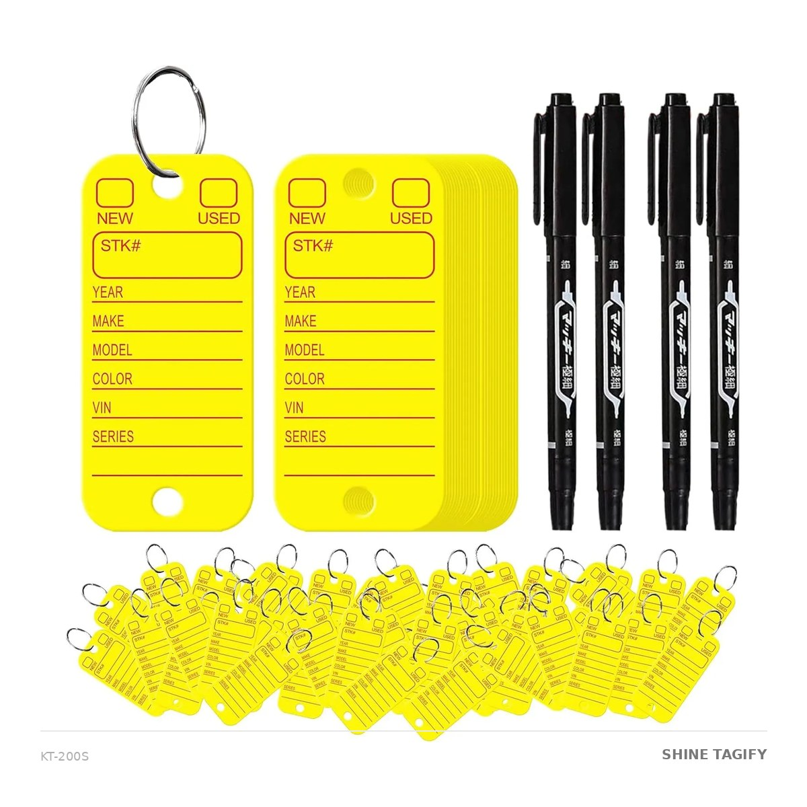

# 怎么改这个网站（中文说明）

站点是**纯静态页面**，没有任何后台/数据库，改哪个文件就改哪一块内容。
改完提交到 GitHub，1–2 分钟后 https://1023t.github.io/shinetagify-site/ 自动更新。

---

## 一、文件都是干什么的

| 文件 | 对应哪个页面 | 什么时候改它 |
|---|---|---|
| `index.html` | 首页 | 改首页大标题、首页三个分类入口、首页主推的 4 款产品 |
| `products.html` | 产品总览 | 加/删产品型号、改「Full range at a glance」那张表 |
| `key-tags.html` | 钥匙标签专页 | 改钥匙标签的型号、规格、下单流程 |
| `tags-labels.html` | 吊牌 + 贴纸/卷标专页 | 改吊牌、乙烯基标、卷筒标签的内容 |
| `metal-plates.html` | 金属标牌/停车牌专页 | 改金属牌、停车牌、车牌架内容 |
| `factory.html` | 工厂 + 展会 | 换工厂照片、改展会说法 |
| `contact.html` | 询价页 | 改收件邮箱、表单字段 |
| `assets/site.css` | **全站样式**（颜色/字号/间距） | 改配色、字体大小、页宽 —— 改这一处全站生效 |
| `img/` | 所有图片 | 换产品图、工厂图 |

---

## 二、最常见的三种修改

### 1）改文字
打开对应 `.html`，浏览器的记事本/VS Code 都能开，直接改英文文字，别的别动，保存提交。

> 每个产品卡片长这样，改 `<h3>` 里的名字、`spec` 里的规格就行：
> ```html
> <h3>Self-Locking Key Tags</h3><div class="spec">Yellow · writable fields · 200 pcs</div>
> ```

### 2）换图片
1. 把新图片放进 `img/` 文件夹（建议宽度 1000–1400px，JPG，单张 < 300KB）
2. 在页面里找到旧图片名，替换成新文件名：
   ```html
   
   ```
   → 改成 ``
3. `alt` 里写英文描述（对 Google 收录有用）

### 3）加一个新页面（比如「案例 / Case studies」）
1. 复制 `factory.html` 存成 `cases.html`
2. 改里面的大标题和正文，`<title>` 也改掉
3. 每个页面的顶部导航里加一行：`<a href="cases.html">Cases</a>`（**7 个页面都要加**，手机菜单 `<div class="mnav-panel">` 里也要加一行）

---

## 三、颜色 / 字号想统一改

只改 `assets/site.css` 最上面这几行：

```css
:root{
  --ink:#14161a;      /* 深色（页头、页脚、标题） */
  --accent:#f5c400;   /* 主题黄，按钮和强调线用这个 */
  --max:1180px;       /* 页面最大宽度 */
}
```
按钮想换成品牌蓝：`--accent:#0a5bd3;` 即可，全站跟着变。

---

## 四、发布（如果你自己在电脑上改）

```bash
git add -A
git commit -m "改了什么"
git push
```
- 仓库：`1023T/shinetagify-site`
- 发布后看效果：https://1023t.github.io/shinetagify-site/
- GitHub Pages 有 1–2 分钟缓存，改完没变化就等一会儿再刷新（手机上加 `?v=2` 强制刷新）

---

## 五、换自己的域名（shinetagify.com）

在阿里云 DNS 只改这两条，**MX / SPF 千万别动**（动了邮件就断）：

| 记录 | 主机 | 值 |
|---|---|---|
| A | `@` | `185.199.108.153` |
| CNAME | `www` | `1023t.github.io` |

再到仓库 Settings → Pages → Custom domain 填 `shinetagify.com`，勾上 HTTPS。
`index.html` 里的 `og:image` 和 `sitemap.xml` 里的地址，换域名后要一起改成新域名。

---

## 六、现在各页面之间怎么连的

```
index.html（首页）
 ├─ products.html（产品总览）
 │    ├─ key-tags.html        钥匙标签
 │    ├─ tags-labels.html     吊牌 / 贴纸 / 卷标
 │    └─ metal-plates.html    金属标牌 / 停车牌 / 车牌架
 ├─ factory.html（工厂 + 展会）
 └─ contact.html（询价表单）
```
产品卡片上的「Get quote」都指向 `contact.html?product=型号`，点进去会自动把型号填进表单 —— 这是唯一需要 JS 的地方，代码在 `contact.html` 底部。
